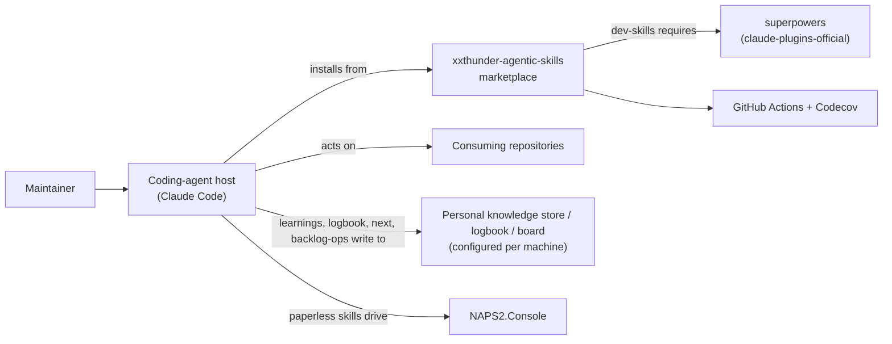
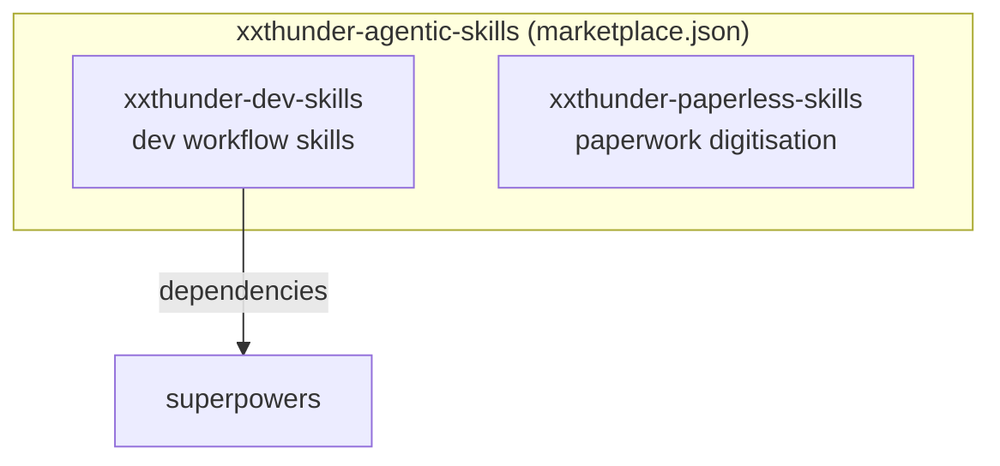
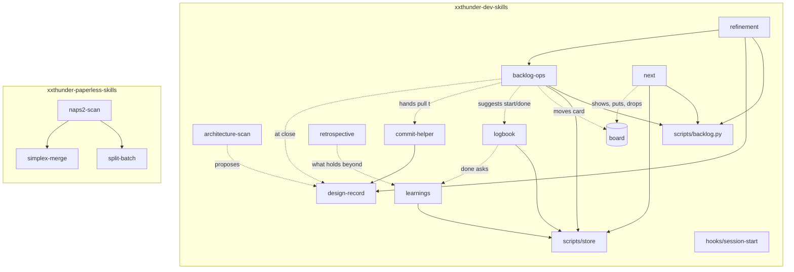
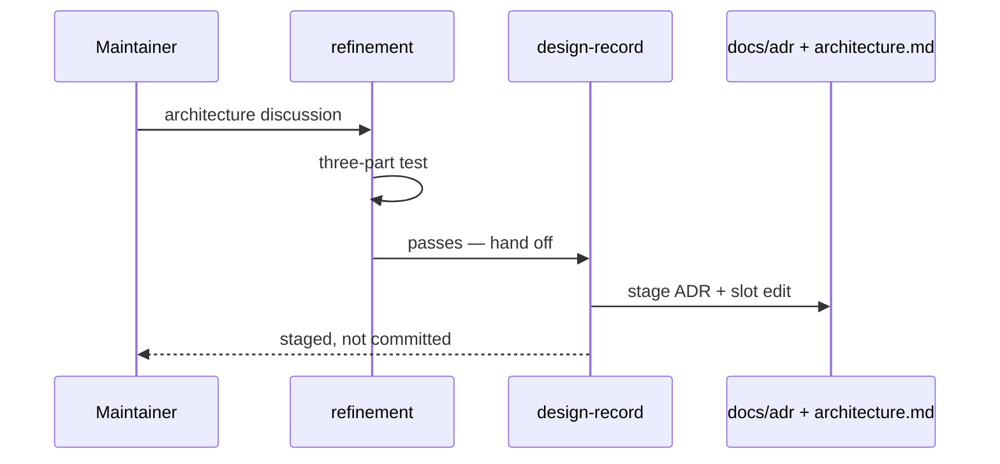
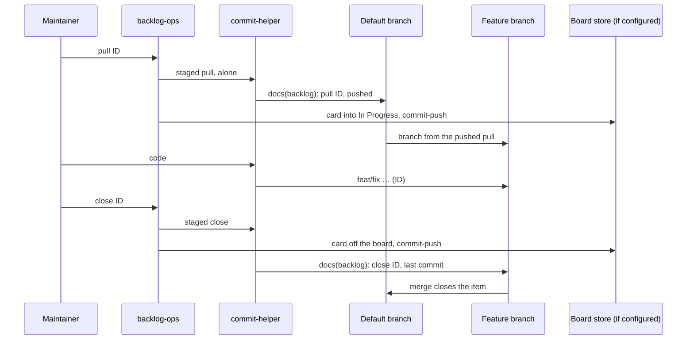
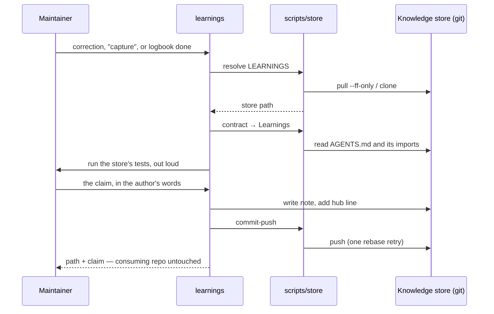
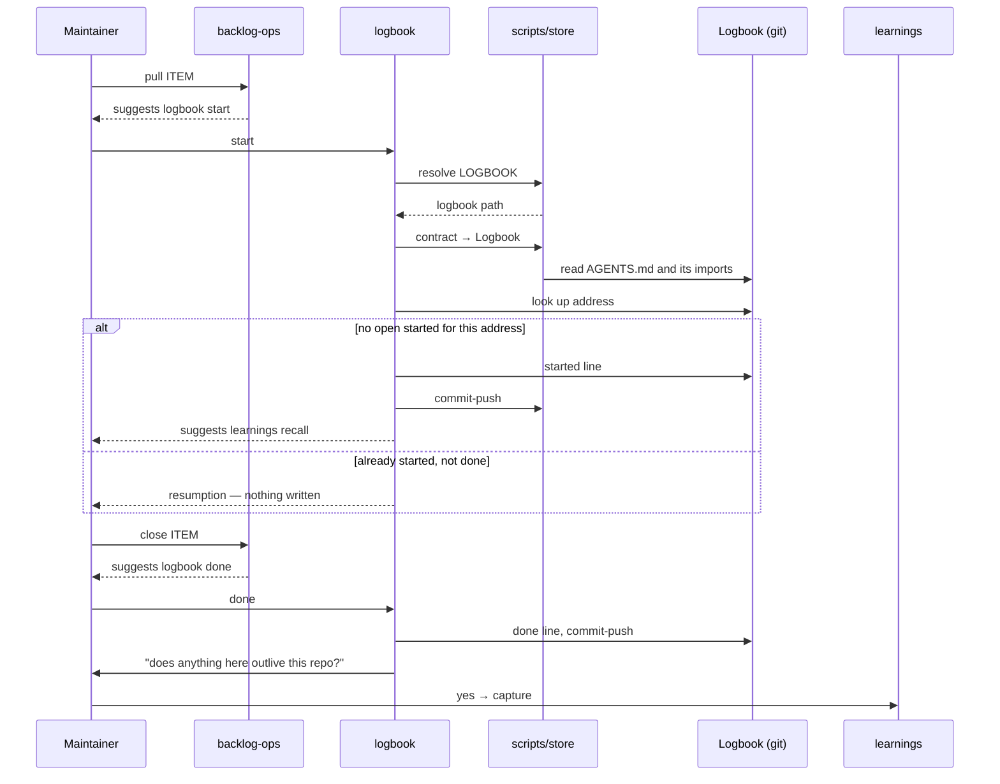
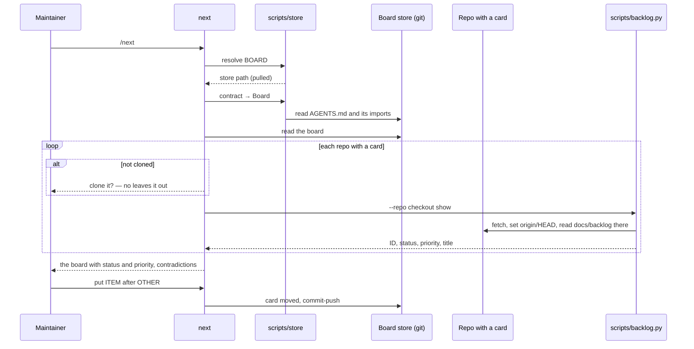

# Architecture

## Purpose

A marketplace of agentic skill plugins. It hosts plugins that extend coding
agents with reusable skills, distributed through the agent's own plugin system
rather than copied between repositories. Claude Code is the current target;
additional agent targets are planned.

## System context

A maintainer works through a coding-agent host. The host installs plugins from
this marketplace and acts on a consuming repository. Through `learnings`,
`logbook`, `next` and `backlog-ops` it also writes to the maintainer's personal knowledge
store, logbook and board — git repos (one or several) the host knows only from the user's own
settings, never from any consuming repository (ADR-0007). `xxthunder-dev-skills` declares a hard dependency on `superpowers`,
which lives in a different marketplace. The paperwork skills drive NAPS2.Console locally. CI runs on
GitHub Actions with coverage reported to Codecov.

## Containers

Two independently installable units, each versioned on its own line.

A user may install either without the other. `xxthunder-dev-skills` pulls in
`superpowers` automatically; `xxthunder-paperless-skills` has no dependencies.

The `pyproject.toml` and `tests/` harness is deliberately **not** a container.
It sets `package = false` and ships to nobody — it exists so `uv run pytest`
can exercise the plugin helper scripts and the hook.

## Components

**`xxthunder-dev-skills`** — nine skills, all markdown, plus two pieces of
executable code: a `SessionStart` hook under `hooks/` (`hooks.json`, an
extensionless `session-start`, and a polyglot `run-hook.cmd` that locates a
bash on Windows), and two plugin-level scripts under `scripts/`.

`scripts/` is the plugin's place for executable helpers **shared by more than
one skill**; a helper used by a single skill stays in that skill's own
directory, as the paperless plugin does. `store` is a POSIX sh script
reached as `${CLAUDE_PLUGIN_ROOT}/scripts/store`: it
resolves a cross-repo store from a variable pair (`<PREFIX>_PATH`,
`<PREFIX>_REMOTE`), prints a contract section from the store's `AGENTS.md`
or any file it pulls in with an `@path` import line (one section in one place,
XAS-045), and commits-and-pushes into it, with one rebase retry.
`learnings` calls it with the `LEARNINGS` prefix, `logbook` with `LOGBOOK`,
`next` and `backlog-ops` with `BOARD`; the stores may be one repo or several. `backlog.py` is a PEP 723 Python script
run with `uv run`; `refinement` and `backlog-ops` call it for every mechanical
backlog step — allocating an ID, setting a status with its epic cascade,
regenerating the README table of contents from the item files (ADR-0009), and
checking the backlog. `next` calls its one read-only command, `show`, which
prints an item's ID, status, priority and title — with `--repo`, for another
repository, read at its remote's default branch without touching its working
tree. `backlog-ops` calls `show --in-progress <ID>` before it makes a card on a
pull: it prints only an item In Progress as work, epics and the standing
refinement item left out, and its title is the card's. Mechanics with a right answer live in the scripts and
are tested; judgment — running a store's tests for a learning, drafting from
its template, finding the right place for a log line, wording an item — stays
in `SKILL.md`.

Four skills carry a `references/` file. Two of those are load-bearing beyond
their own skill: `design-record`'s `adr-format.md` and `refinement`'s
`backlog-format.md` state rules that other components read rather than restate,
which is why a rule lives in exactly one of them.

`refinement` and `retrospective` are conversation skills; `backlog-ops` is
mechanics-only; `design-record` is the sole writer of the record;
`architecture-scan` is read-only and proposes into it; `commit-helper` sits at
the boundary of a change. `learnings`, `logbook` and `next` are the three skills whose
output is a store: they write to their store and nothing
else, under the store's own rules (ADR-0008). `backlog-ops` is the one skill
that writes both: its own repository, and — when a board is configured — one
commit in the board's store per pull and per close, moving the item's card
(ADR-0011). It reaches `logbook` by suggestion only — one line after a pull,
one after a close — the same seam `commit-helper` uses towards `design-record`.
The board and the logbook know nothing of each other.

**`xxthunder-paperless-skills`** — three skills carrying eight PEP 723 helper
scripts run via `uv run`: `naps2-scan` (3 scripts), `simplex-merge` (1),
`split-batch` (4). This is the bulk of the repository's executable code, but no
longer all of it: the `SessionStart` hook and `scripts/store` above are shell,
`scripts/backlog.py` is Python, and `tests/` is split `tests/paperless/` for the
helper scripts, `tests/dev/` for the hook, the store resolver, the backlog
script, and the backlog and ADR-log invariants.

## Key flows

### Recording a design decision

A decision failing the three-part test stays in the backlog item's
`Scope Decisions` and never reaches the ADR log.

`backlog-ops` is the fourth route in. When completing an item it re-reads the
`Description` and `Scope Decisions`, applies the same three-part test, and
offers a hand-off for anything still binding that is sitting inside. Closing is the
last moment that lift can happen, because nothing keeps a closed item current.

### Bootstrapping or auditing the architecture

`architecture-scan` derives structure from directories, manifests, entry points
and dependency edges, then reports — a bootstrap proposal against an empty
document, a drift report against a populated one. It never writes; approved
output is applied by `design-record`.

### Backlog lifecycle

`refinement` authors items — `scripts/backlog.py new` allocates the ID, writes
the skeleton and lists it, and the agent writes the free text; `backlog-ops`
performs every status mutation through `scripts/backlog.py`, which applies the
epic cascade and regenerates the README table of contents from the items;
`commit-helper` commits what it stages.
Neither authors content.

A pull and a close land in different places, because they claim different
things. *In Progress* says that someone is working on the item: the pull is
committed on its own to the default branch and pushed before the feature branch
exists, so other sessions and `next` see it at `origin/HEAD`. *Done* says that
the default branch contains the work: the close stays the last commit on the
feature branch, and the merge closes the item.

With a board configured, the card follows the transition at once: into the
in-progress column on the pull, off the board on the close — before the merge,
so for the life of the pull request the item is In Progress on the default
branch with no card (ADR-0011). Without one, those two steps do not happen.

Where the repository's rules send backlog changes through a pull request, or
the push is refused, the pull stays staged and rides on the feature branch.

### Session orientation

The `SessionStart` hook fires on `startup|clear|compact`, discovers which record
artifacts exist in the current repository, and injects their locations. It is
silent in repositories that use none of these conventions.

### Capturing a learning

The store is resolved fresh on every operation and only from the user's
settings (ADR-0007); its `AGENTS.md` supplies template, hub, tests and language
(ADR-0008). The claim is never drafted by the agent. `recall` runs the first
half — resolve, read the contract, search — and writes nothing.

### Chronicling a session

`backlog-ops` never calls `logbook` and does not know whether one is configured;
it ends its pull and close with a one-line suggestion. `logbook` resolves the
logbook fresh (ADR-0007), takes line format, placement and address rules from
the logbook's `AGENTS.md` (ADR-0008), commits one line at a time — the log
file alone, even when the logbook is the working repository — and never edits
a line. A `started` already open for the same address makes `start` a no-op —
resumption is not a new start. The capture question at `done` is how
`learnings` is reached at the end of an item without `backlog-ops` knowing it
exists.

### What comes next

A card holds the link to its item, the item's title and the author's reason;
status and priority are read from each item every time, and a title that has
drifted from its item is reported. A repo with a card is fetched and read at
`origin/HEAD`, never pulled, by `backlog.py` (ADR-0010): another session may
be working in that checkout, and its working tree, index and `HEAD` stay as
they were. Only the store is pulled, by the resolver, because the board is
written there. Columns, card format, link, checkout location and commit
subject come from the store's `AGENTS.md` (ADR-0008). `show` reports
contradictions between the board and the backlogs rather than smoothing them
over, and writes nothing. `backlog-ops` moves cards on pull and close
(ADR-0011); `next` places and drops them by hand.

### Digitising paperwork

`naps2-scan` drives NAPS2.Console with OCR, then chains into `simplex-merge`
for double-sided documents scanned on a simplex scanner, or `split-batch` to
divide a multi-document batch.

## Glossary

Only three terms in this repository carry explicit definitions, all in
[the backlog conventions](backlog/README.md):

- **Epic** — a top-level item with at least one letter-suffixed substory.
  Emergent, not a type field.
- **Substory** — a letter-suffixed child (`XAS-027a`); the suffix encodes the
  parent, so no back-reference is stored.
- **ID prefix** — the per-repository item prefix (`XAS` here), discovered from
  the backlog README rather than configured.

## Decisions

Recorded as ADRs — see [docs/adr/README.md](adr/README.md).
